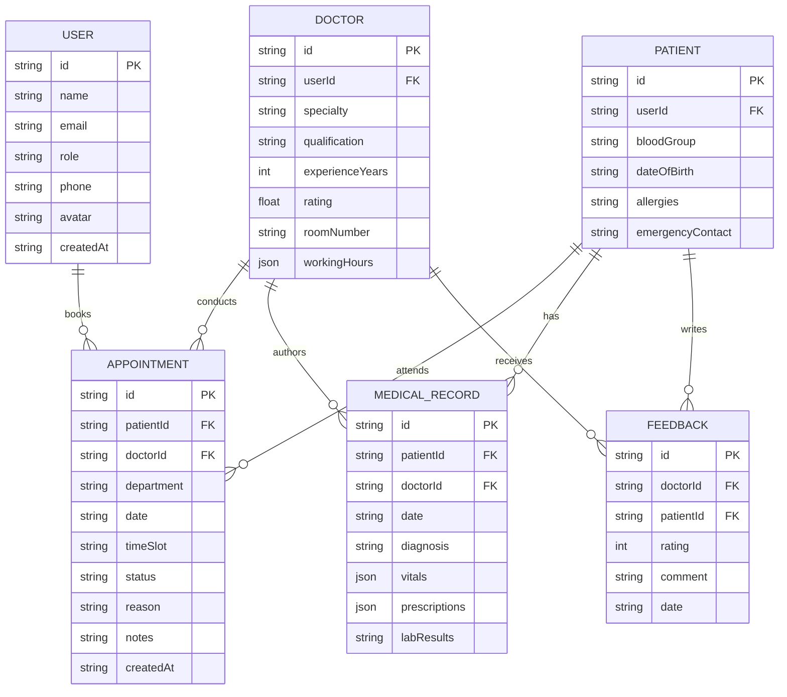

# Product Requirements Document (PRD)
## Online Healthcare Management System (OHMS)
**Version:** 1.0  
**Status:** Approved & Implemented  
**Author:** Healthcare Systems Engineering Team  
**Institution / Platform:** GUVI Geek Network Pvt. Ltd. Project Submission  

---

## 1. Executive Summary
The **Online Healthcare Management System (OHMS)** is a comprehensive, centralized digital health platform engineered to streamline clinical scheduling, doctor consultation workflows, patient health records, and administrative oversight. 

The system provides dedicated role-based portals for three primary stakeholders:
1. **Administrators:** Oversee user accounts (staff and patients), global appointment queues, performance metrics, and clinical operating parameters.
2. **Doctors:** Manage daily consultation availability, calendar schedules, patient electronic health records (EHR), clinical notes, and patient reviews.
3. **Patients:** Explore available specialists, book and reschedule consultations, view diagnostic records and prescription histories, and maintain personal health profiles.

---

## 2. System Architecture & Role-Based Access Control (RBAC)

### 2.1 User Roles & Permissions Matrix

| Capability / Module | Patient | Doctor | Administrator |
| :--- | :---: | :---: | :---: |
| Self-Registration & Profile Management | ✅ | ✅ | ✅ |
| Browse Specialists & Department Directory | ✅ | ✅ | ✅ |
| Book / Reschedule / Cancel Own Appointments | ✅ | ❌ | ✅ (All) |
| Manage Consultation Schedule & Working Hours | ❌ | ✅ | ✅ |
| View & Update Patient Electronic Medical Records (EMR) | ✅ (Self-Read) | ✅ (Full Read/Write) | ✅ (Auditing) |
| Add Diagnosis, Vitals & Prescriptions | ❌ | ✅ | ❌ |
| Submit Doctor Feedback & Ratings | ✅ | ❌ | ❌ |
| View Doctor Ratings & Patient Feedback | ❌ | ✅ (Self) | ✅ (All) |
| Manage User Accounts (Create / Edit / Deactivate) | ❌ | ❌ | ✅ |
| Global Appointment Oversight & Rescheduling | ❌ | ❌ | ✅ |
| Hospital Performance Analytics & Utilization Metrics | ❌ | ❌ | ✅ |
| Configure System Settings & Department Rules | ❌ | ❌ | ✅ |

---

## 3. Detailed Functional Specifications

### 3.1 Administrator Portal
The Administrator dashboard provides full operational visibility over the hospital's day-to-day operations.

1. **User Management Module:**
   - **Inputs:** Name, Email, Role (Admin / Doctor / Patient), Department/Specialty, Contact Number, Status (Active / Suspended).
   - **Operations:** Add new doctor or staff accounts, search and filter existing accounts, edit details, and toggle account statuses.
   - **Outputs:** Real-time user roster, status confirmation toasts, and audit logs.

2. **Appointment Oversight Module:**
   - **Inputs:** Appointment date ranges, status filters (Confirmed, Pending, Completed, Cancelled), Doctor/Patient IDs.
   - **Operations:** Master schedule table displaying all hospital bookings, manual emergency reassignments, and cancellations.
   - **Outputs:** Synchronized appointments table with status badges and quick action controls.

3. **System Configuration Module:**
   - **Inputs:** Clinical operating hours (default 08:00 - 18:00), consultation slot durations (15m, 30m, 45m), automated reminder toggles, maintenance mode switch.
   - **Operations:** Real-time persistence of hospital operational policies.
   - **Outputs:** Updated system configuration applied across booking engines.

4. **Performance & Operational Analytics:**
   - **Metrics:** Total consultations, revenue/billing estimates, department load distribution (Cardiology, Neurology, Pediatrics, General Medicine, Orthopedics), bed/room utilization, average patient satisfaction ratings.
   - **Visualizations:** Visual charts and KPI metric cards.

---

### 3.2 Doctor Portal
The Doctor portal equips healthcare practitioners with high-efficiency clinical tools to focus on patient care.

1. **Schedule & Availability Management:**
   - **Inputs:** Daily working hours, break intervals, vacation/leave dates, maximum patients per day.
   - **Operations:** Interactive schedule calendar showing time slots, occupied consultations, and available buffer slots.
   - **Outputs:** Dynamic calendar and real-time slot blocking for patients.

2. **Patient Medical Records (EMR / EHR):**
   - **Inputs:** Patient identifiers, vital signs (BP, Heart Rate, SpO2, Temperature, BMI), clinical diagnosis notes, prescription regimens (drug, dosage, instructions), lab order requests.
   - **Operations:** Searchable patient directory; historical record viewer; clinical note editor with timestamped entries.
   - **Outputs:** Comprehensive medical timeline, printable summaries, and updated patient records.

3. **Appointment Overview & Consultation Workflow:**
   - **Inputs:** Consultation outcome, notes, status change (`In Progress`, `Completed`, `No Show`).
   - **Operations:** Triage queue of upcoming patients for today, past consultations history, and direct link to the patient's medical dossier.
   - **Outputs:** Updated appointment status, patient notification alert.

4. **Patient Feedback & Ratings:**
   - **Inputs:** Patient ratings (1-5 stars) and qualitative feedback comments.
   - **Operations:** Aggregate rating metric, review breakdown, and sentiment list.
   - **Outputs:** Doctor satisfaction score and constructive review feed.

---

### 3.3 Patient Portal
The Patient portal delivers a frictionless, empathetic digital health experience for patients and caregivers.

1. **Appointment Booking Engine:**
   - **Inputs:** Medical department, preferred practitioner, appointment type (In-person / Telehealth), preferred date, available slot selection, chief medical complaint.
   - **Operations:** Live slot checking (prevents double bookings), instant reservation, auto-sync with doctor calendar.
   - **Outputs:** Immediate digital booking confirmation, appointment ticket reference code, calendar sync.

2. **Appointment Management & History:**
   - **Inputs:** Appointment selection, reschedule requests, cancellation reasons.
   - **Operations:** Tabbed view of `Upcoming`, `Completed`, and `Cancelled` appointments; cancellation action within permissible time windows.
   - **Outputs:** Real-time status tracker and action confirmations.

3. **Medical History & Health Records:**
   - **Inputs:** Filter by diagnosis or date.
   - **Operations:** Read-only chronological stream of consultations, clinical observations, diagnostic findings, and prescription slips.
   - **Outputs:** Searchable digital health record history with printable summary exports.

4. **Profile & Emergency Details Management:**
   - **Inputs:** Full name, phone, email, date of birth, blood group, allergies, chronic conditions, emergency contact information.
   - **Operations:** Self-service profile updating and secure credential management.
   - **Outputs:** Persistent health profile used for pre-filling clinical intakes.

---

## 4. Data Models & Entity Relationships

---

## 5. UI/UX Design System Guidelines

- **Color Palette:**
  - Primary Brand: Deep Clinical Cyan (`#0d9488` / `teal-600`) & Medical Sapphire (`#0284c7` / `sky-600`)
  - Accent / Highlights: Mint Green (`#10b981`), Amber Warning (`#f59e0b`), Rose Coral (`#f43f5e`)
  - Backgrounds: Ultra-clean slate whites (`#f8fafc`) with frosted glassmorphism overlays
  - Dark/Light Mode: High-contrast legible typography complying with WCAG AA accessibility standards
- **Typography:**
  - Modern sans-serif: `Inter`, `Plus Jakarta Sans`, system-ui
- **Micro-Interactions:**
  - Smooth card transitions, animated status badges, skeleton loaders, instant modal popups, and non-blocking toast alerts.

---

## 6. Implementation Milestones

1. **Phase 1: Foundation & Design System**
   - Core HTML5 semantic layouts, comprehensive CSS design tokens, typography, and responsive grid layouts.
2. **Phase 2: Data Store & State Management**
   - Modular LocalStorage repository with seeded demo data for doctors, patients, appointments, records, and system settings.
3. **Phase 3: Interactive Portals & Role Switching**
   - Dynamic top bar role switcher allowing seamless transitions between Administrator, Doctors (e.g. Dr. Sarah Mitchell), and Patients (e.g. Alex Johnson).
4. **Phase 4: Functional Workflows**
   - Complete booking wizard, appointment status transitions, medical record additions, user CRUD, system settings saving, and real-time dashboard analytics charts.
5. **Phase 5: Verification & Quality Assurance**
   - Comprehensive cross-role validation and responsive testing across desktop, tablet, and mobile viewports.
